# 블로그 글 깃허브 자동화 최적화 설계, 검증 결과

## 1. Project Overview

### 요구사항 분석

| 요구사항 | 검증 가능한 정의 |
|---|---|
| 동시 사용자 | 20 VU가 동시에 시작하고 서로 다른 글 2개씩 순차 수정 |
| 요청 응답 | 수정 API 전체 요청의 p95 ≤ 1,000ms |
| 전체 완료 | 첫 수정 요청 시작부터 마지막 DB 저장 응답까지 총 40건이 1,000ms 이내에 완료 |
| GitHub 반영 | 응답 이후 처리해도 됨. 반영 상태와 실패는 추적 가능해야 함 |
| 서비스 유지 | 지정 부하와 GitHub 지연·장애 조건에서 저장·조회가 계속 동작하고 요청 실패가 없어야 함 |
| 프로세스·서버 장애 | 별도 검증 항목. 단일 인스턴스 장애까지 무중단을 요구하면 중복 배치와 장애 전환도 필요 |

### 기존 아키텍처

**기능**: 블로그 생성, 수정, 삭제 시 깃허브 자동 푸시

**기존 구조** : 블로그 생성, 수정, 삭제 시 한 트랜잭션 안에 깃허브 API호출하는 구조

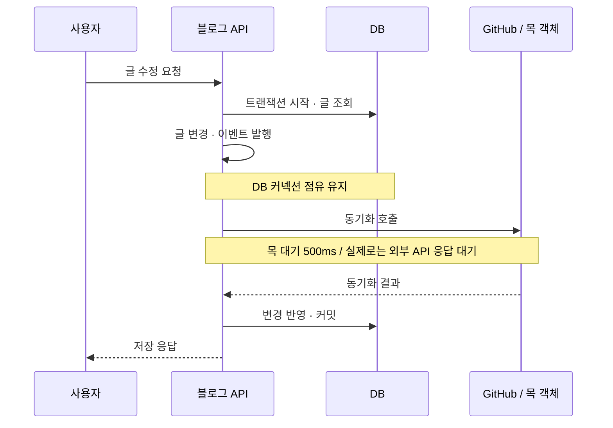

  <a href="image-1.png">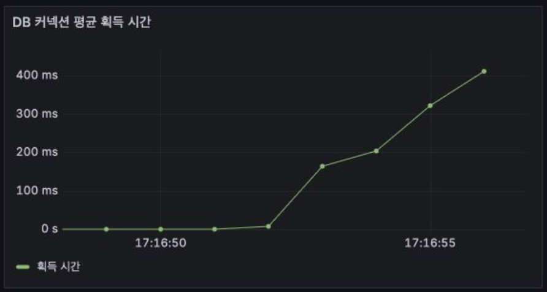</a>
  <a href="image-2.png">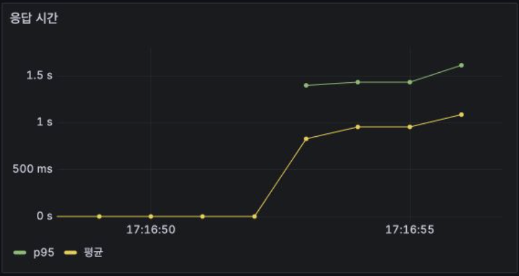</a>

항목 | 목표 | 현재 관측 | 판단 |
|---|---:|---:|---|
| 수정 요청 p95 | ≤ 1.000초 | 1.135초 | 미달 |
| 40건 전체 HTTP 완료 | ≤ 1.000초 | 약 2.190초 | 미달 |
| 사용자별 두 수정 완료 p95 | 참고 지표 | 약 2.194초 | 사용자 흐름도 1초 초과 |
| 기능 오류 | 0건 | 0 / 40건 | 이번 부하에서는 성공 |
| 서비스 중단 | 없어야 함 | 이번 정상 목 테스트에서는 미발생 | 장애 상황 가용성까지 증명한 것은 아님 |
| 커넥션 대기 | 원인 진단 지표 | 최대 관측 10개 | 외부 대기와 자원 경합 확인 |

### 목표

**트랜잭션 병목 해결하기**:
- 데이터 정합성 문제: 깃허브 API 성공 후 DB 롤백
- DB 커넥션 풀 점유 문제: 깃허브 API 응답이 느려질 경우 커넥션 풀을 오래 점유

## Architecture Driver

### 이해관계자

블로그 작성자: 저장 요청이 빠르게 완료되고, 깃허브 동기화 상태를 확인할 수 있다.

백엔드 개발자: 글 저장과 깃허브 동기화의 원자성 확보 및 실패, 중복, 재시작 시 복구 가능성 확보

운영자: 미처리, 실패 작업 Redis대기열, DB 커넥션 대기를 관측할 수 있어야함

### 대안

| 대안 | 구조 | 성능 목표와의 관계 | 신뢰성 |
|---|---|---|---|
| 쿼리 최적화 | 계층형 동기 요청응답 | 500ms가 그대로 남아 전체 완료 1초에 맞지 않음 |  문제 유지 |
| 트랜잭션 밖에서 동기 호출 | DB를 먼저 커밋하고 요청 스레드가 GitHub 호출 | 커넥션 점유는 줄지만 사용자 응답은 여전히 GitHub를 기다림 | DB 성공 후 GitHub 실패의 복구 필요 |
| 메모리 이벤트 `@Async` | 커밋 후 메모리 큐로 전달 | 응답 경로에서 외부 대기를 제거할 수 있음 | 프로세스 종료·큐 초과 시 작업 유실 또는 접수 공백 가능 |
| **PostgreSQL 아웃박스 + Redis Stream + 작업자** | **계층형 앱 유지 + Web-Queue-Worker 형태** | **저장 응답에서 GitHub 대기를 제거하고 재측정** | **DB에 작업을 영속화하고 Stream으로 전달. 중복, 재시도, 정리 관리 필요** |
| 마이크로서비스, 추가 브로커 | 동기화 서비스를 별도 배포하거나 Kafka 등을 추가 | 독립적인 확장, 격리에 유리 | 운영 복잡도와 인프라 비용 증가 |

Redis 도입은 GitHub 동기화만을 위한 결정이 아니다. 리프레시 토큰과 로그아웃한 토큰의 만료 시각을 TTL로 관리하고, 사양이 낮은 EC2에 메모리 캐시를 직접 두는 부담을 줄이려는 계획이 있다.

**결론: PostgreSQL 아웃박스, Redis Stream, Web-Queue-Worker방식 채택**

## System Context

**시스템 아키텍처**

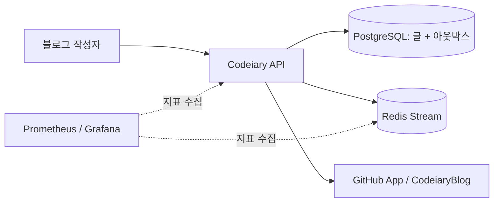

**시퀀스 다이어그램**

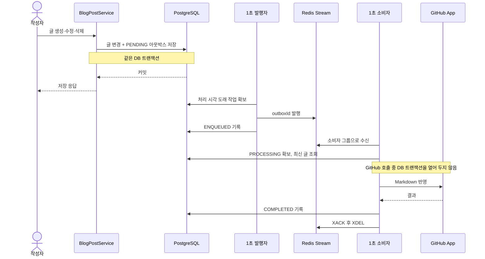

## Architecture Style & Tactics

아키텍처 스타일: Outbox + Web–Queue–Worker

블로그 API는 기존 계층형 구조를 유지한다. 글을 저장할 때 PostgreSQL에 글 변경과 아웃박스 작업을 함께 커밋하고 사용자에게 응답한다. 같은 애플리케이션에서 실행되는 발행자와 작업자가 이후 Redis Stream을 거쳐 GitHub에 반영한다.

## Architecture Tactics

| 품질 목표 | 적용한 택틱 | 구현 방식 |
|---|---|---|
| 응답 성능 | 긴 작업을 요청 경로에서 분리 | 글 저장 요청에서는 GitHub API를 호출하지 않는다 |
| DB 자원 보호 | 트랜잭션을 짧게 유지 | 글과 아웃박스 저장을 커밋한 뒤, 작업자가 별도 단계에서 GitHub를 호출한다 |
| 작업 유실 방지 | 영속적인 작업 기록 | 글 변경과 `PENDING` 작업을 같은 PostgreSQL 트랜잭션에 저장한다 |
| 장애 복구 | 재시도와 미완료 작업 회수 | 발행 실패는 DB에 남기고, 소비자가 중단된 메시지는 다시 확보한다 |
| 중복 처리 | 멱등성 확보 | 같은 작업이 재전달될 수 있음을 전제로 GitHub 파일의 현재 내용을 확인한다 |
| 과부하 제한 | 한 번에 처리할 작업 수 제한 | 발행·소비 배치 크기를 설정해 한 주기에 처리할 작업을 제한한다 |
| 장애 추적 | 상태 기록과 관측 | `PENDING`부터 `COMPLETED`, `FAILED`까지 상태를 남기고 작성자가 확인한다 |

### 택틱 선택 이유:

기존 구조에서는 GitHub 응답을 기다리는 동안 글 저장 응답도 늦어졌다. 특히 외부 호출이 지연되면 DB 커넥션을 오래 점유해 다른 요청까지 대기할 수 있었다. 비동기 처리는 이 외부 대기를 저장 API의 응답 시간에서 제거하기 위한 선택이다.

비동기로 옮기는 것만으로는 작업 유실을 막을 수 없다. 글을 커밋한 직후 프로세스가 종료되면 메모리에만 있던 동기화 작업은 사라질 수 있다. 그래서 트랜잭션 아웃박스로 글 변경과 작업 기록을 함께 저장했다. 여기서 원자적으로 보장하는 범위는 글과 아웃박스 기록이다. PostgreSQL 커밋과 GitHub 반영이 하나의 트랜잭션으로 묶이는 것은 아니다.

Redis Stream은 작업을 전달하고 소비자 그룹이 처리 상태를 관리하는 통로다. 재시도해야 할 작업의 기준은 PostgreSQL 아웃박스에 남긴다. 작업이 중복 전달될 가능성도 있으므로, GitHub에 쓰기 전 현재 파일을 확인하고 처리가 끝난 뒤 DB 상태를 기록한다.

### 적용 범위와 검증 기준

성능 목표는 20VU, 2분동안 40건의 DB 저장 응답을 각각 1초 안에 끝내는 것이다.

GitHub 반영 완료 시간은 별도로 측정한다.

GitHub나 Redis에 일시적인 장애가 나도 이미 접수된 글 저장 작업은 DB에 남는다.

다만 현재 단일 애플리케이션 인스턴스가 중단되면 그동안 새 요청을 받을 수 없다. GitHub 장애와 작업자 장애의 복구는 이 설계에서 다루지만, 서버 자체의 무중단 운영은 다중 인스턴스와 장애 전환을 갖춘 뒤 별도로 검증해야 한다.

### Risk Management

| 상황 | 처리 |
| --- | --- |
| 글 저장 트랜잭션 실패 | 글과 작업이 함께 롤백 |
| Redis 발행 실패 | DB 작업을 남기고 재시도 |
| 소비자 중단, 미확인 메시지 | 소비자 그룹 pending을 일정 시간 뒤 회수 |
| GitHub 일시 오류 | 5초 후 재시도 가능, 실패 횟수 누적 |
| GitHub 쓰기 성공 후 DB 완료 기록 실패 | 같은 작업을 다시 호출할 수 있음 |
| 최대 실패 횟수 도달 | `FAILED`로 보존, 백오피스에서 처리하기|

## Architecture 평가

**환경**

Spring, PostgreSQL: 각각 CPU 2개, 메모리 1GiB

Redis: CPU 0.5개·메모리 256MiB

API: 실제 GitHub 대신 호출당 500ms 대기하는 목 클라이언트를 사용

rchitecture 평가 — 2분 분산 부하와 장애 검증

Docker 환경에서 **20VU, 100VU **로 각각 진행.
사용자는 자기 글 2개를 한 번씩 수정한다. 첫 수정은 앞 1분, 두 번째 수정은 다음 1분에 사용자별로 분산했다.

### 20VM

| 지표 | 결과 |
| --- | ---: |
| HTTP 성공 | **20/20건** |
| 저장 API p95 | **40.75ms** |
| 동기화 완료 | **20/20건** |
| 건별 동기화 중앙값 / p95 / 최장 | **7.53초 / 2.50초 / 2.95초** |

<a href="image-11.png">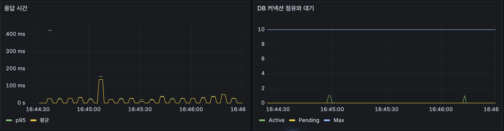</a>

<a href="image-10.png">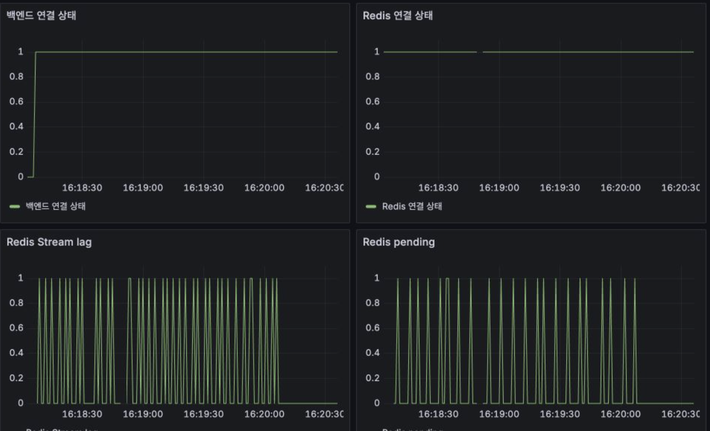</a>

### 100VM

| 지표 | 결과 |
| --- | ---: |
| HTTP 성공 | **200/200건** |
| 저장 API p95 | **64.95ms** |
| 동기화 완료 | **200/200건** |
| 건별 동기화 중앙값 / p95 / 최장 | **7.53초 / 11.04초 / 13.51초** |

<a href="image-12.png">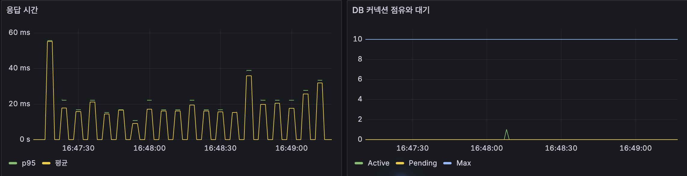</a>

<a href="image-4.png">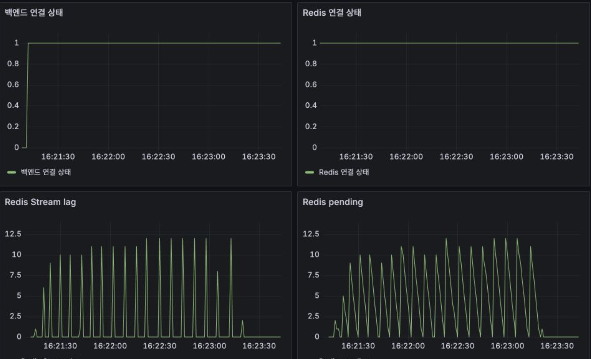</a>

### 장애 상황

GitHub 일시 실패, Redis 중단, PostgreSQL 중단, 백엔드 재시작은 **100명 200건을 2분에 분산**한 채 각각 새 환경에서 실행했다. GitHub 지속 실패는 20명 40건으로 실행했다. 1,000명 장애 시험은 실행하지 않았다.

| 상황 | 저장 API | 최종 아웃박스 | 동기화 p95 | 해석 |
| --- | ---: | ---: | ---: | --- |
| GitHub 목 호출 처음 10회 실패 | 200/200 성공 | 200 `COMPLETED` | 13.03초 | 재시도 후 모두 완료 |
| Redis 15초 중단 후 복구 | 200/200 성공 | 200 `COMPLETED` | 23.43초 | DB에 남은 작업을 복구 후 처리 |
| PostgreSQL 15초 중단 후 복구 | 199/200 성공, HTTP 500 1건 | 저장된 199건 `COMPLETED` | 27.78초 | DB 중단 중 저장 보장 불가 |
| 백엔드 재시작 | 175/200 성공, 연결 실패 25건 | 저장된 175건 `COMPLETED` | 11.97초 | 단일 인스턴스 재시작 중 무중단 아님 |
| GitHub 목 호출 지속 실패 | 40/40 저장 성공 | **40 `FAILED`** | 해당 없음 | 재시도 상한 뒤 운영자 처리 필요 |

GitHub 일시 실패 시험에서는 최장 동기화가 16.36초였다. 목 클라이언트 실패 로그 10건을 확인했고, 모든 작업이 최종 완료됐다.

<a href="image-5.png">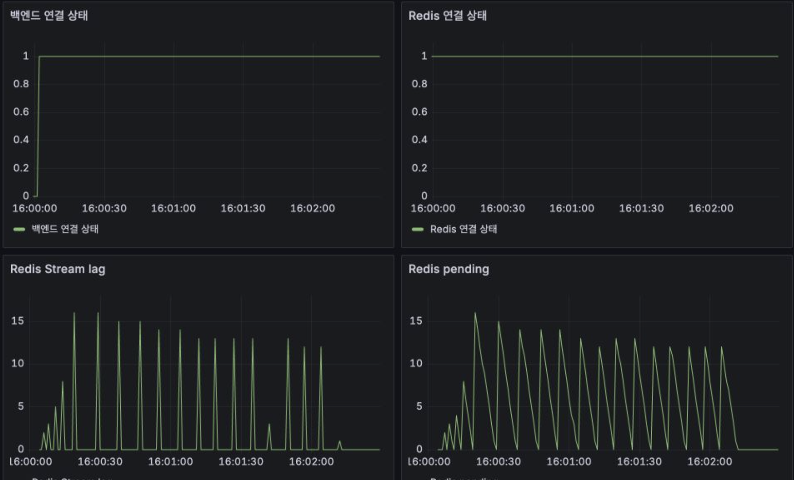</a>

Redis 중단 시험에서는 연결 상태가 0으로 떨어지는 구간과 복구 후 Stream 대기량이 줄어드는 모습이 보인다. 건별 동기화 중앙값은 19.44초, 최장은 28.13초였다.

<a href="image-6.png">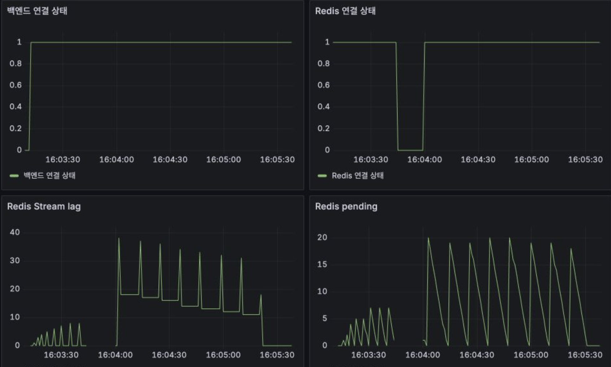</a>

PostgreSQL 중단 시험은 요청 중 하나가 HTTP 500을 반환했다. 다른 요청도 DB 복구를 기다려 저장 API p95가 **11.98초**로 늘었다. 복구 뒤 DB에 기록된 199건은 모두 완료됐지만, 실패한 1건에는 아웃박스 작업이 없다.

<a href="image-7.png">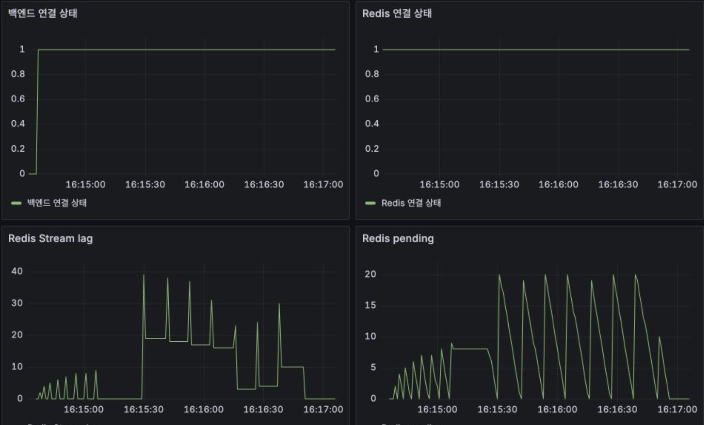</a>

백엔드 재시작 중에는 `EOF` 24건과 연결 거부 1건이 발생했다. 재시작 후에는 접수된 175건의 작업이 모두 완료됐다. 이 시험은 **작업 복구**를 확인한 것이며 **요청 무중단**을 확인한 것이 아니다.

<a href="image-8.png">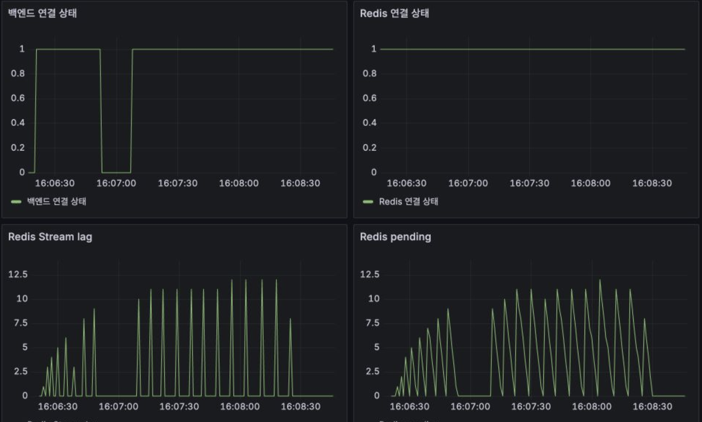</a>

GitHub가 계속 실패한 시험은 저장 요청 자체에는 영향을 주지 않았다. 하지만 동기화는 성공하지 못했고, 40건 모두 `FAILED`에 도달하는 데 첫 저장부터 **261.21초**가 걸렸다. 이 값은 동기화 완료 시간이 아니라 **실패 상태 확정 시간**이다.

<a href="image-9.png">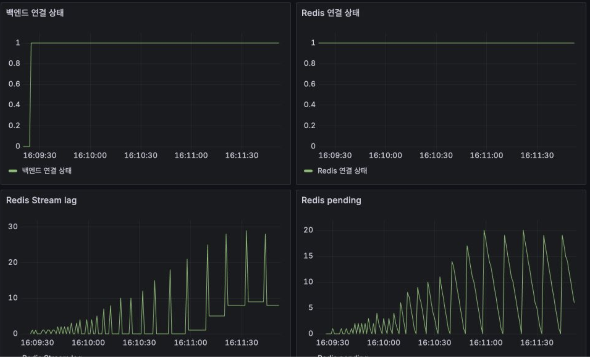</a>

### 평가

현재 구조는 저장 트랜잭션에서 외부 호출을 분리해, GitHub나 Redis가 느리거나 멈춰도 **접수된 글 변경과 아웃박스 기록을 보존**한다. 반면 소비자가 목 GitHub 호출을 순차 처리하므로 작업이 들어오는 속도에 따라 반영 지연이 커진다. 100명·200건 시험에서 저장 API p95는 64.95ms였지만 동기화 p95는 11.04초였다. 두 지표를 별도로 운영해야 한다.

또한 DB 중단 중의 저장 요청과 단일 백엔드 재시작 중의 요청은 실패할 수 있다. 아웃박스는 이미 접수된 작업을 복구하는 방식이지, 단일 인스턴스나 DB의 무중단을 보장하지 않는다. `FAILED` 작업은 자동 성공으로 처리하지 않고 재처리, 알림 절차가 필요하다.
