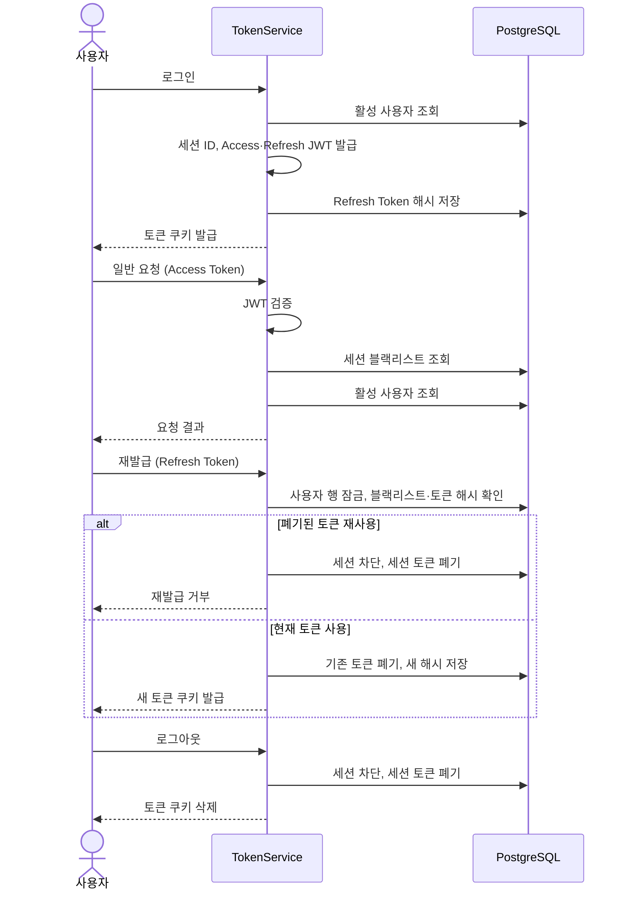
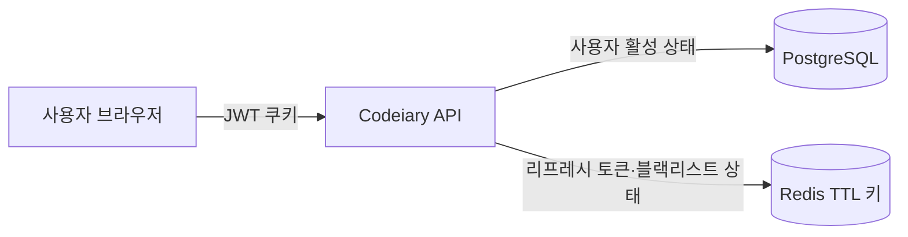
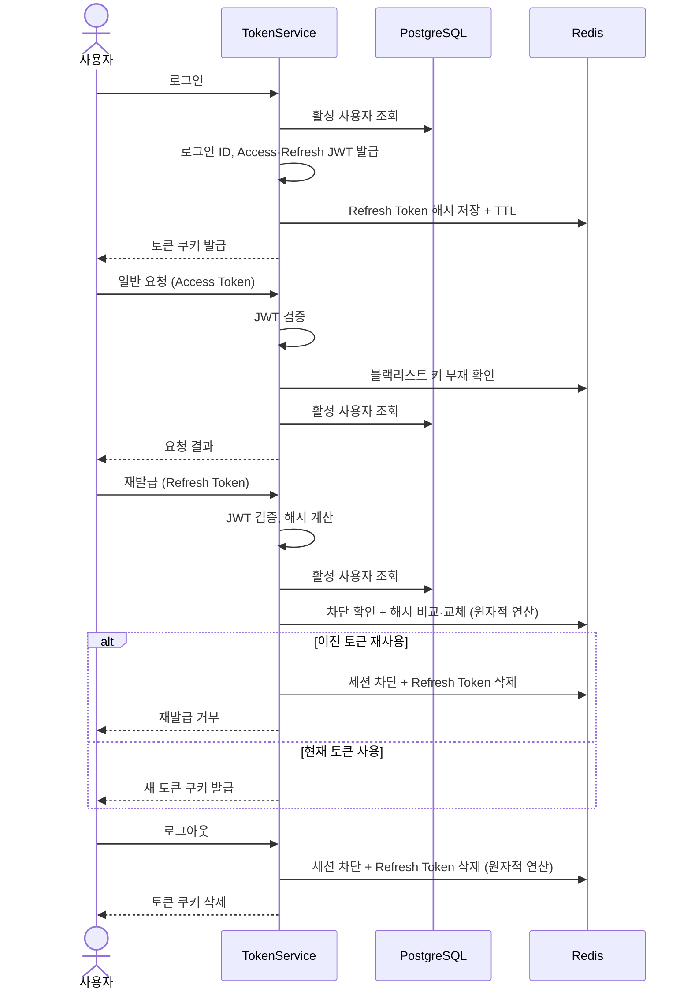

# ARCH-002 리프레시 토큰과 블랙리스트 Redis 전환 설계

> 구현 상태: 리프레시 토큰과 블랙리스트를 Redis로 전환했다. V8 마이그레이션으로 기존 DB 토큰 테이블을 삭제하며, 기존 로그인은 재로그인이 필요하다.

## 1. Project Overview

### 요구사항 분석

| 요구사항 | 검증 가능한 정의 |
| --- | --- |
| 로그인 | 활성 사용자의 Refresh Token 해시를 Redis에 저장한 뒤 토큰 쿠키를 발급한다. |
| 재발급 | 현재 Refresh Token만 한 번 사용한다. 이전 토큰을 다시 쓰면 세션을 차단한다. |
| 로그아웃 | 해당 세션의 Refresh Token을 제거하고 남은 Access Token도 거부한다. |
| 일반 요청 | JWT를 검증하고 Redis의 블랙리스트 키가 없는지 확인한다. 사용자 활성 상태도 확인한다. |
| 만료 | 세션의 최종 만료 시각에 맞춰 Redis 키가 만료된다. 재발급으로 만료 시각을 연장하지 않는다. |
| 장애 | Redis에서 차단 여부를 확인하지 못하면 보호된 요청을 인증하지 않는다. |
| 기존 세션 | DB에 저장된 활성 세션을 어떻게 처리할지 정한 뒤 저장소를 전환한다. |

### 기존 아키텍처

**기능:** JWT를 쿠키로 발급한다. Refresh Token의 원문 대신 SHA-256 해시를 PostgreSQL에 저장한다. 로그아웃한 세션 ID도 PostgreSQL의 블랙리스트에 저장한다.

만료된 `refresh_token`과 `token_blacklist` 행은 `TokenCleanupScheduler`가 삭제한다.

### 목표

- Refresh Token 해시와 차단된 로그인 ID를 TTL이 있는 Redis 키로 관리한다.
- 토큰 원문은 서버 저장소에 남기지 않는다.
- 기존의 JWT, HttpOnly 쿠키, 재발급 시 토큰 교체와 재사용 탐지 정책을 유지한다.
- 저장소 전환으로 기존 로그인이 예기치 않게 끊기지 않도록 처리 방침을 정한다.

## 2. Architecture Driver

### 이해관계자

**사용자:** 로그인 상태가 유지되고, 로그아웃하거나 토큰을 재발급할 때 기존과 같은 결과를 얻는다.

**백엔드 개발자:** 동시 재발급과 이전 토큰 재사용을 정확히 처리한다. DB와 Redis의 책임을 구분한다.

**운영자:** Redis 장애와 키 유실이 인증에 미치는 영향을 확인한다. 기존 세션 전환과 만료 키 정리를 관리한다.

### 대안

| 대안 | 구조 | 장점 | 이 설계에서의 판단 |
| --- | --- | --- | --- |
| PostgreSQL 유지 | Refresh Token 해시와 블랙리스트를 DB에 저장 | 현재 동작을 유지하며 추가 인프라가 필요 없다 | 만료 행 정리와 토큰 상태 조회를 계속 DB가 맡는다 |
| 블랙리스트만 Redis로 이동 | Refresh Token은 DB, 블랙리스트 키는 Redis | 일반 요청의 블랙리스트 조회를 Redis로 옮긴다 | 한 세션의 폐기 처리가 두 저장소에 걸친다 |
| Refresh Token만 Redis로 이동 | 해시는 Redis, 블랙리스트는 DB | Refresh Token의 TTL을 Redis가 관리한다 | 일반 요청의 블랙리스트 조회는 DB에 남는다 |
| **두 정보를 Redis로 이동** | **리프레시 토큰 해시와 블랙리스트 키를 로그인 ID로 관리** | **TTL과 재발급·로그아웃 처리를 한 저장소에서 관리** | **선택. Redis 장애·키 유실에 대한 인증 정책이 필요하다** |
| 블랙리스트 없는 JWT | 서명과 만료만 검사 | 서버 저장소 조회가 줄어든다 | 로그아웃한 Access Token을 만료 전까지 즉시 차단할 수 없다 |

인증에는 Redis의 TTL이 있는 일반 키를 사용한다. 두 기능의 키와 접근 로직은 분리한다.

**선택: Refresh Token 해시와 세션 블랙리스트를 Redis로 옮긴다.** 사용자 계정과 활성 상태는 PostgreSQL에서 계속 확인한다.

### 선택한 방식의 이점

| 항목 | 현재 PostgreSQL | 변경 후 Redis | 얻는 이점 |
| --- | --- | --- | --- |
| 일반 요청의 인증 확인 | 블랙리스트와 사용자를 각각 DB에서 조회 | 블랙리스트는 Redis, 사용자는 DB에서 조회 | 일반 요청의 DB 조회 한 건을 Redis 조회로 옮긴다 |
| 만료 데이터 정리 | 만료된 토큰·블랙리스트 행을 스케줄러가 삭제 | 각 키가 TTL에 따라 만료 | 정리 스케줄러와 만료 행 삭제 쿼리가 필요 없어짐 |
| 재발급 기록 | 교체할 때마다 새 Refresh Token 행을 추가하고 이전 행을 폐기 | 리프레시 토큰 키에서 현재 해시를 교체하고 사용한 해시를 만료까지 보관 | DB 행은 늘지 않지만 Redis 해시 필드는 재발급 횟수만큼 늘어남 |
| 재발급·로그아웃 | 사용자 행 잠금과 여러 DB 행 변경 | 로그인 ID의 키를 원자적으로 변경 | 토큰 교체에 사용자 DB 행 잠금을 사용하지 않아도 됨 |
| 인증 상태 관리 | Refresh Token과 블랙리스트를 별도 테이블로 관리 | 두 키를 Redis에서 관리 | 토큰 상태와 만료 규칙을 한 저장소에 모음 |

이점은 현재 코드와 설계안을 비교한 결과다. Redis 조회가 실제 응답 시간을 얼마나 줄이는지는 아직 측정하지 않았다. 사용자 활성 상태 조회는 PostgreSQL에 남는다. Redis 장애나 키 유실에 대비할 운영 책임도 생긴다.

## 3. System Context

### 시스템 아키텍처

### 변경 후 시퀀스 다이어그램

| Redis 키 | 값 | TTL |
| --- | --- | --- |
| `auth:refresh:{loginId}` | 사용자 ID, 현재 Refresh Token 해시, 사용한 해시 이력, 최종 만료 시각 | Refresh Token의 최종 만료 시각까지 |
| `auth:revoked:{loginId}` | 차단 표시 | 해당 로그인의 마지막 토큰 만료 시각까지 |

재발급해도 로그인 ID와 Refresh Token의 최종 만료 시각은 유지한다. JWT에는 로그인 ID를 기존 `sid` 클레임에 담는다. Redis에는 토큰 원문을 저장하지 않는다.

## 4. Architecture Style & Tactics

**아키텍처 스타일:** JWT 인증과 Redis의 블랙리스트 조회를 결합한다. 사용자는 JWT를 쿠키로 보낸다. 백엔드는 PostgreSQL에서 계정 상태를 확인한다. 리프레시 토큰 해시는 재발급 시 Redis에서 확인한다.

| 품질 목표 | 적용한 택틱 | 구현 방식 |
| --- | --- | --- |
| 만료 관리 | TTL | 토큰의 남은 유효 시간만큼 Redis 키를 유지한다 |
| 동시 재발급 제어 | 원자적 비교·교체 | 현재 해시와 일치할 때만 새 해시로 바꾼다 |
| 토큰 재사용 탐지 | 로그인 단위 차단 | 이전 Refresh Token을 다시 쓰면 로그인 ID를 차단한다 |
| 로그아웃 | 즉시 차단 | 블랙리스트 키 등록과 리프레시 토큰 키 삭제를 원자적으로 처리한다 |
| 키 유실 방지 | 임의 축출 방지 | 인증 키가 만료 전에 삭제되지 않도록 Redis 메모리 정책을 정한다 |
| 장애 시 인증 보호 | 확인 실패 시 거부 | Redis에서 차단 여부를 확인하지 못하면 인증을 통과시키지 않는다 |

### 택틱 선택 이유

현재 재발급은 사용자 행을 잠가 동시 요청을 제어한다. Redis로 옮기면 해시 확인과 교체를 분리해서 실행해서는 안 된다. 두 요청이 같은 해시를 읽을 수 있기 때문이다. 차단 확인, 해시 비교, 교체를 Lua 스크립트나 동등한 원자적 연산으로 묶는다.

로그아웃할 때는 블랙리스트 키를 먼저 기록하고 리프레시 토큰 키를 지워야 한다. 두 명령 사이에 장애가 나면 일부 상태만 바뀔 수 있으므로 한 번의 원자적 연산으로 처리한다. Refresh Token 쿠키가 없고 Access Token만 남은 경우도 처리한다. 리프레시 토큰 키가 없으면 Access Token의 남은 유효 시간을 블랙리스트 키의 TTL로 사용한다.

### 적용 범위

| 현재 구성 | 변경 방향 |
| --- | --- |
| `RefreshTokenRepository`, `TokenBlacklistRepository` | 인증용 Redis 저장소로 교체 |
| 기존 `TokenSessionService`의 DB 토큰 조회·저장 | `TokenService`의 Redis 상태 조회와 원자적 재발급·로그아웃 호출로 교체 |
| `TokenCleanupScheduler` | 전환이 끝나면 제거 |
| `refresh_token`, `token_blacklist` 테이블 | V8 마이그레이션으로 제거. 기존 DB 세션은 사용할 수 없으므로 재로그인 필요 |

`JwtTokenProvider`, 토큰 쿠키, PostgreSQL의 사용자 활성 상태 확인은 유지한다.

## 5. Risk Management

| 상황 | 처리 |
| --- | --- |
| Redis 연결 실패 | 리프레시 토큰·블랙리스트 상태를 확인할 수 없는 요청은 인증하지 않는다. 토큰 상태를 저장하지 못하면 발급도 완료하지 않는다 |
| 동시 재발급 | 한 요청만 현재 해시를 교체한다. 다른 요청은 이전 토큰 재사용 정책에 따라 처리한다 |
| Redis 키 조기 삭제 | 리프레시 토큰 키가 사라지면 재발급할 수 없다. 블랙리스트 키가 사라지면 만료 전 Access Token이 다시 승인될 수 있어 인증 키의 임의 축출을 막아야 한다 |
| Redis 노드 데이터 유실 | 빈 Redis로 복구되면 기존 Refresh Token은 재발급할 수 없지만 만료 전 Access Token은 승인될 수 있다. 차단 기록 유실에 대비한 운영 절차가 필요하다 |
| Redis 접근 권한 노출 | 사설망 접근 제한, TLS, 인증·권한 설정으로 키 조회·삭제 권한을 제한한다 |
| 기존 DB 세션 | 활성 세션을 Redis로 옮기거나 재로그인을 받는 방침을 전환 전에 정한다 |
| 로그아웃 중 일부 명령 실패 | 블랙리스트 키 등록과 리프레시 토큰 키 삭제를 원자적으로 실행한다 |

## 6. Architecture 평가

구현 후 아래 동작을 로컬 Testcontainers Redis와 API 통합 테스트로 확인했다. 운영 성능 수치는 측정하지 않았다.

| 검증 항목 | 기대 결과 | 현재 상태 |
| --- | --- | --- |
| 로그인 후 재발급 | 기존 토큰이 교체되고 새 토큰만 사용 가능 | 통합 테스트 통과 |
| 이전 Refresh Token 재사용 | 재발급과 Access Token 요청이 거부됨 | 통합 테스트 통과 |
| 동시 재발급 | 같은 이전 토큰으로 두 개의 유효한 새 토큰이 만들어지지 않음 | Redis 동시 실행 테스트 통과 |
| 로그아웃 | 쿠키가 삭제되고 남은 Access Token도 거부됨 | 통합 테스트 통과 |
| Redis 장애 | 보호된 요청과 토큰 발급이 차단됨 | 운영 장애 주입은 아직 하지 않음 |
| 리프레시 토큰 키 유실 | 재발급은 거부하되 만료 전 Access Token은 블랙리스트에 없으면 승인함 | 단위 테스트 통과 |
| TTL 만료 | 만료된 리프레시 토큰 키가 자동으로 사라짐 | Redis 테스트 통과 |
| 기존 세션 전환 | 이관·재로그인 정책대로 동작함 | 배포 전 결정 필요 |
