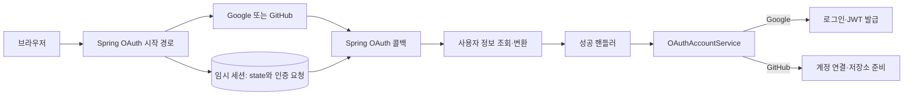

# ARCH-003 Google OIDC와 GitHub OAuth2 연동

## 두 인증의 역할

| | Google | GitHub |
| --- | --- | --- |
| 목적 | Codeiary 로그인 | 로그인한 사용자에게 GitHub 계정 연결 |
| 방식 | OIDC | OAuth2 |
| 시작 | `/oauth2/authorization/google` | `/oauth2/authorization/github` |
| 콜백 | `/login/oauth2/code/google` | `/login/oauth2/code/github` |
| 결과 | 사용자 조회·가입 후 Codeiary JWT 쿠키 발급 | `github_connection` 저장, Codeiary JWT 추가 발급 없음 |

두 경로 모두 Spring Security의 OAuth 흐름을 사용한다. GitHub만을 위한 별도 시작 API는 없다.

## 공통 흐름

임시 세션은 로그인 상태를 유지하는 수단이 아니다. OAuth 왕복 중 `state`와 시작 요청을 대조하는 데 사용한다. 로그인 후 일반 API는 Codeiary JWT 쿠키로 인증한다.

## Google: 서비스 로그인

1. 비로그인 사용자도 `/oauth2/authorization/google`에서 시작할 수 있다.
2. Google 콜백에서 Spring이 `state`와 OIDC ID Token을 검증한다.
3. `CustomOidcUserService`가 Google 정보를 `AuthInfo`로 변환한다.
4. `OAuthAccountService`가 Google `sub`로 기존 사용자를 찾거나 새 사용자를 만든다. 신규 사용자는 `PENDING` 권한을 받는다.
5. `TokenService`가 Codeiary JWT를 발급한다. 성공 핸들러는 이를 `HttpOnly` 쿠키로 쓰고 프론트의 `/auth/callback`으로 돌려보낸다.

Google의 검증된 이메일만 가입·연결에 사용한다. 기존 계정에 이메일로 연결할 때는 검증된 Gmail 주소 또는 Google Workspace의 `hd` 정보를 요구한다. 자세한 토큰 수명과 재발급 규칙은 [인증 문서](../guides/authentication.md)에 있다.

## GitHub: 기존 사용자 계정 연결

1. 로그인한 `USER` 또는 `ADMIN`이 `/oauth2/authorization/github`에서 시작한다. 인증 필터가 OAuth 리다이렉트 필터보다 먼저 Codeiary JWT를 확인한다.
2. 시작 요청에 Codeiary 사용자 ID와 시각을 담은 `GitHubLinkContext`를 넣고, OAuth 요청과 `state`를 임시 세션에 보관한다.
3. 콜백에서 Spring이 `state`를 확인하고 GitHub 사용자 정보를 가져온다. `CustomOAuth2UserService`가 이를 `AuthInfo`로 변환한다.
4. `GitHubConnectionService`가 시작 당시의 Codeiary 사용자와 GitHub의 **숫자 사용자 ID**를 연결한다. 시작 정보가 없거나 10분이 지났으면 거부한다.
5. `GitHubRepositoryService`가 개인 계정의 `CodeiaryBlog` 저장소를 준비하고 앱 설치 권한을 확인한다.
6. 성공 핸들러가 프론트의 `/auth/callback`으로 돌려보낸다. 이 과정에서는 Codeiary JWT를 새로 발급하지 않는다.

비로그인 시작 요청은 401, 온보딩 전 사용자의 요청은 403이다. GitHub 로그인명은 바뀔 수 있으므로 계정 식별에는 숫자 ID를 사용한다. 사용자 ID와 GitHub 사용자 ID의 UNIQUE 제약이 중복 연결을 막는다.

### CodeiaryBlog 준비

GitHub App에는 `Metadata: Read`, `Contents: Read & Write`, `Repository creation: Write` 권한이 필요하다.

- 내 저장소가 이미 있으면 재사용한다. 없으면 비공개 저장소를 만든다.
- 앱 설치가 이 저장소에 `Contents: Write` 권한을 가졌는지 확인한 뒤 설치 ID를 저장한다.
- 저장소는 만들어졌지만 설치 승인이 없으면 설치 ID는 비어 있다. 프론트는 이를 연동 완료로 표시하지 않는다.
- 설치 승인 후 다시 GitHub 연동을 시작하면 기존 저장소를 재사용한다. 앱 설치 화면에서는 `Only select repositories`로 `CodeiaryBlog`만 허용한다.

저장소 생성과 DB 저장은 하나의 트랜잭션이 아니다. 저장소를 만든 뒤 다른 단계가 실패하면 다음 시도에서 같은 저장소를 재사용한다. 외부 GitHub 호출 중에는 사용자 행의 DB 잠금을 유지하지 않는다.

### 연결 상태와 실패

| 상황 | 처리 |
| --- | --- |
| OAuth 인증 실패 | `/auth/callback?error=oauth2` |
| 계정 연결 후 저장소 준비 실패 | `/auth/callback?error=github_repository`; 기존 Codeiary 로그인은 유지 |
| GitHub OAuth 토큰 만료·서버 재시작 | 저장소 준비를 다시 하려면 GitHub 재인증 필요 |
| 연동 해제 | DB 연결과 Spring Authorized Client 삭제; 원격 저장소는 유지 |

GitHub OAuth 토큰은 Spring의 메모리 Authorized Client 저장소에 둔다. 자동 푸시는 별도의 GitHub App 설치 토큰을 사용하며, 앱 개인 키가 필요하다. 이 두 자격 증명은 OAuth Client Secret과도 다르다. 글 저장 후 아웃박스와 Redis Stream을 거쳐 GitHub에 반영하는 과정은 [ARCH-001](<ARCH-001 블로그 글 깃허브 자동화 설계.md>)에서 설명한다.
