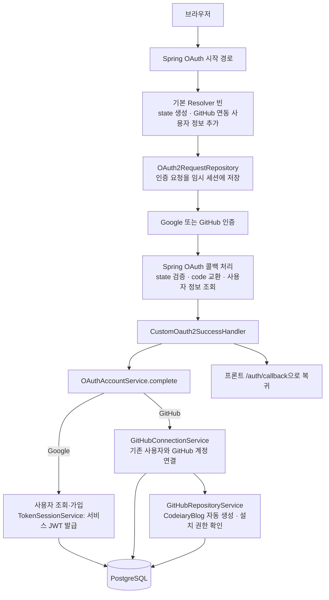
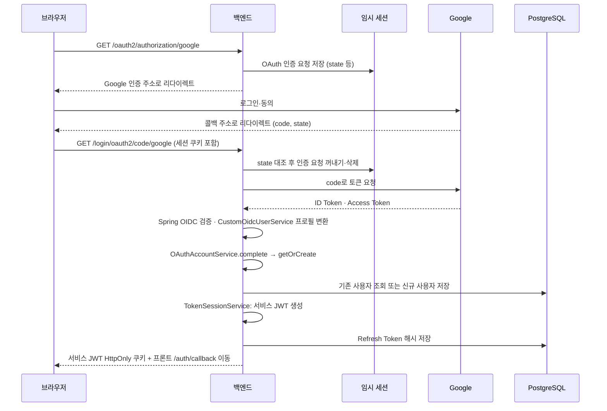
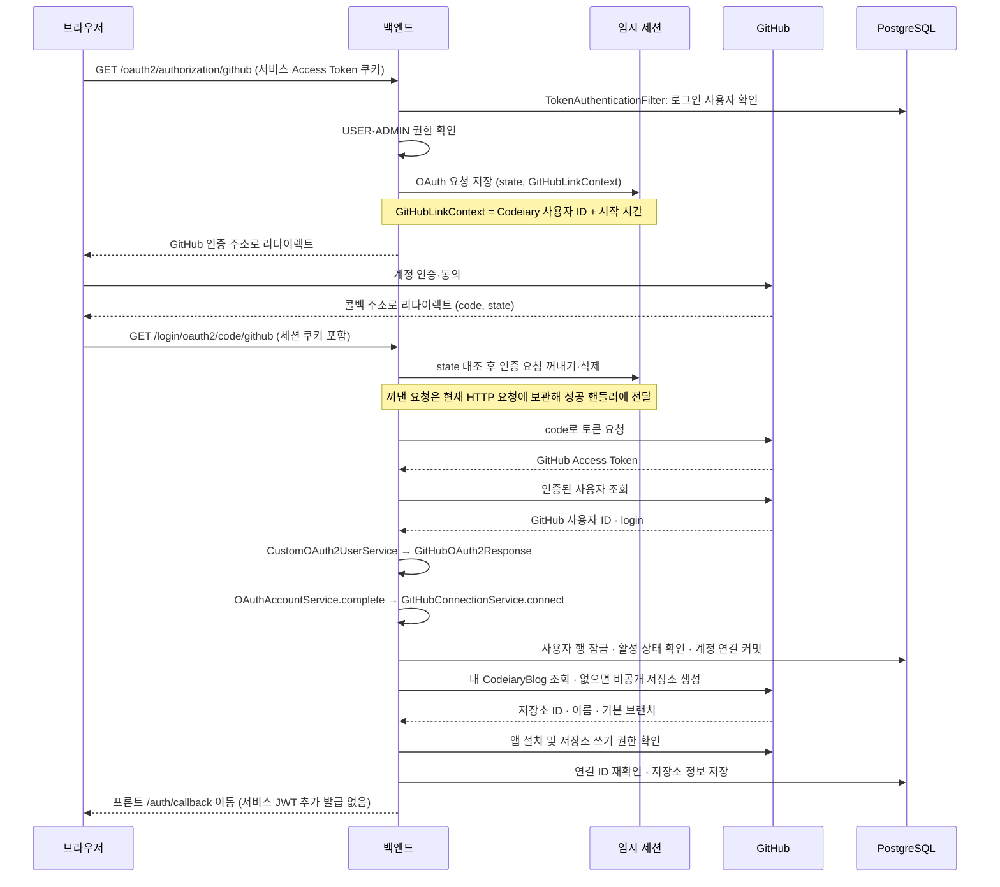

# OAuth 로그인과 GitHub 연동

## OAuth2 로그인과 JWT 쿠키

기존 이메일·비밀번호 로그인 API 대신 Google OAuth2/OIDC 로그인을 사용합니다.
`/oauth2/authorization/google`에서 시작하며, 처음 로그인한 사용자는 온보딩 대기 권한인 `PENDING`으로 가입합니다.
Google의 검증된 이메일(`email_verified=true`)을 요구하고, 계정은 제공자(`provider`)와
Google 사용자 식별자(`sub`)로 식별합니다. 이미 연결된 계정은 이메일이 변경되어도 같은 사용자로 조회합니다.
OAuth 연결 정보가 없는 기존 계정은 검증된 Gmail 주소 또는 Google Workspace의
`hd` 클레임이 있는 이메일일 때만 이메일 일치로 연결합니다. 다른 OAuth 계정에 이미 연결된
이메일은 충돌로 처리하며, 비활성 계정은 로그인할 수 없습니다.
Google 설정에는 `GOOGLE_CLIENT_ID`, `GOOGLE_CLIENT_SECRET`이 필요하며,
로그인 성공 후 이동할 주소는 `OAUTH2_REDIRECT_HOME`으로 설정합니다.
로컬 실행은 `.env.example`을 참고해 IDE 실행 환경에 세 값을 등록하고,
운영 배포는 SSM Parameter Store의 `/codeiary/prod/google-client-id`와
`/codeiary/prod/google-client-secret`을 사용합니다. 운영 리디렉션 주소는
`https://codeiary.com/auth/callback`입니다.

로그인 성공 시 JJWT로 Access Token과 Refresh Token을 발급하고 `HttpOnly` 쿠키로 전달합니다.
운영에서는 `Secure`, `SameSite=Strict`를 사용합니다. 쿠키 이름·경로·도메인 등은
`src/main/resources/application.yml`의 `token.cookie`에서 설정합니다.

| 요청 | 경로 | 입력 / 인증 | 성공 응답 |
| --- | --- | --- | --- |
| POST | `/auth/reissue` | `refresh_token` 쿠키, 본문 없음 | 204, 새 인증 쿠키 설정 |
| POST | `/auth/logout` | 인증 쿠키, 본문 없음 | 204, 인증 쿠키 삭제 |
| GET | `/users/me` | PENDING·USER·ADMIN 권한의 `access_token` 쿠키 | 사용자 프로필 JSON |
| GET | `/admin/me` | ADMIN 권한의 `access_token` 쿠키 | 사용자 프로필 JSON |

토큰 재발급·로그아웃은 Access Token이 만료되어도 호출할 수 있습니다.
재발급은 유효한 Refresh Token이 필요하며, 토큰 원문을 응답 JSON에 포함하지 않습니다.
프론트는 `credentials: "include"`로 인증 쿠키를 보내고 `/users/me`로 로그인 상태를 복원합니다.
로그인 후 이동 주소는 `OAUTH2_REDIRECT_HOME`으로 지정하며 프론트의 `/auth/callback`을 사용합니다.

Access Token은 30분, Refresh Token은 최초 로그인부터 7일 동안 유효합니다.
`token.jwt.access-token-ttl`, `token.jwt.refresh-token-ttl`로 변경할 수 있습니다.
재발급해도 최초 7일 만료 시점은 연장되지 않고, Access Token도 이 시점을 넘지 않습니다.
Refresh Token은 원문 대신 SHA-256 해시를 DB에 저장하고, 재발급 시 기존 토큰을 폐기합니다.
폐기된 Refresh Token을 다시 사용하면 해당 로그인 전체를 차단합니다.
클라이언트는 동시에 여러 재발급 요청을 보내지 않아야 합니다.

로그아웃은 로그인 식별자(`sid`)를 PostgreSQL `token_blacklist`에 등록하여
해당 로그인에서 발급한 Access Token·Refresh Token을 모두 차단합니다.
다른 기기의 별도 로그인은 유지됩니다. 유효한 Refresh Token이 없으면 Access Token으로
로그아웃할 수 있고, 유효한 토큰이 없어도 쿠키 삭제와 204 응답을 반환합니다.
계정이 삭제되거나 비활성화되면 인증과 재발급을 차단하며,
요청마다 DB의 현재 권한을 사용하므로 권한 변경도 다음 요청부터 반영됩니다.
`TokenCleanupScheduler`가 매일 새벽 3시(Asia/Seoul)에 만료된 토큰과 블랙리스트 기록을 삭제합니다.
실행 시간과 활성화 여부는 `auth.token-cleanup.cron`, `auth.token-cleanup.enabled`로 설정합니다.

`/admin/**`에는 ADMIN 권한이 필요합니다. `PENDING` 계정은 본인 조회,
닉네임 중복 확인, 온보딩 완료, 토큰 재발급·로그아웃 API와 공개 조회를 사용할 수 있습니다.
프로필 수정 등 나머지 일반 기능은 온보딩을 완료한 `USER` 또는 `ADMIN` 권한이 필요합니다.
GET `/users/me`와 `/users/nickname-availability`에도 인증이 필요하며,
공개 GET `/**`, OAuth2 진입·콜백, 재발급·로그아웃 외의 요청은 인증이 필요합니다.
인증 오류는 401, 권한 부족은 403이며
기존 `{ "message": "...", "code": "..." }` 형식을 사용합니다.
현재 CSRF 검사는 비활성화되어 있고, 인증 쿠키의 SameSite 기본값은 Strict입니다.

JWT 인증 업무는 `domain/auth`에서 관리합니다. `controller/TokenController`는 재발급·로그아웃 API를,
`service/TokenSessionService`는 로그인 세션·재발급·폐기를 담당합니다.
리프레시 토큰과 블랙리스트는 `entity`, `repository`에 두고,
만료된 기록은 `scheduler/TokenCleanupScheduler`에서 정리합니다.
같은 `domain/auth`의 `provider/JwtTokenProvider`는 JWT 생성·검증을,
`cookie/TokenCookieManager`는 쿠키 처리를 담당합니다. 쿠키 관리와 예약 작업은 `@Component`로 등록합니다.
인증 정보인 `AuthInfo`, JWT 발급 결과인 `TokenPair`와 공통 토큰 오류인 `TokenErrorCode`도 이 패키지에서 관리합니다.
`User`가 기존 OAuth 연결의 덮어쓰기를 막으며, 서비스는 이메일·OAuth 식별자 중복만 가입 충돌로 처리합니다.

Spring Security 연동은 `global/security`에 둡니다. OAuth2/OIDC 사용자 정보 조회는 `service`,
인증·인가 오류 응답 처리는 `exception`, 로그인 결과 처리는 `handler`, 사용자 객체와 어댑터는 `dto`에서 담당합니다. 이 연동 클래스들은 `@Component`로 등록하고, 업무 규칙을 처리하는 서비스는 `@Service`로 구분합니다.
요청 인증 필터는 `global/security/filter/TokenAuthenticationFilter`에 둡니다.

### Google 로그인과 GitHub 연동 아키텍처

Google은 **Codeiary 로그인**, GitHub는 **로그인한 사용자의 계정 연동**에 사용합니다.
두 흐름 모두 Spring Security의 OAuth 시작 경로와 콜백 처리를 사용하며,
별도의 GitHub 인증 시작 API는 두지 않습니다.

| 구분 | Google | GitHub |
| --- | --- | --- |
| 목적 | 사용자 조회·가입 후 로그인 | 기존 Codeiary 사용자에게 GitHub 계정 연결 |
| 방식 | OAuth2 + OIDC | OAuth2 |
| 시작 경로 | `GET /oauth2/authorization/google` | `GET /oauth2/authorization/github` |
| 콜백 경로 | `/login/oauth2/code/google` | `/login/oauth2/code/github` |
| 시작 조건 | 비로그인 사용자도 가능 | 로그인한 USER·ADMIN만 가능 |
| 사용자 조회 | `CustomOidcUserService` | `CustomOAuth2UserService` |
| 성공 결과 | 서비스 JWT 쿠키 발급 | `github_connection` 저장, 서비스 JWT 추가 발급 없음 |

#### 공통 처리 구조



`OAuthAccountService`는 `global/security/service`에 두고 인증 성공 후 처리를 모읍니다.
Google 사용자 조회·가입은 내부 `getOrCreate()`에서 처리하고,
GitHub 연결의 저장·조회·해제는 `domain/github`의 `GitHubConnectionService`가 담당합니다.
성공 핸들러는 서비스를 호출하고, 반환된 서비스 JWT가 있을 때만 쿠키를 작성합니다.

#### Google 로그인 흐름



Google 응답은 `GoogleOAuth2Response`가 공통 `AuthInfo`로 변환하는 데 필요한 값을 제공합니다.
기존 계정은 Google의 `sub`로 식별하고, 최초 가입자는 `PENDING` 권한으로 생성합니다.

#### GitHub 연동 흐름



GitHub 시작 요청은 토큰 필터가 OAuth 리다이렉트 필터보다 먼저 처리합니다.
미로그인은 401, 온보딩 전 사용자는 403으로 차단합니다.
콜백에서는 시작할 때 보관한 Codeiary 사용자 ID를 사용하며,
연동 정보가 없거나 시작 후 10분이 지나면 연결하지 않습니다.
GitHub 계정의 식별에는 변경 가능한 `login` 대신 숫자 사용자 ID를 사용하고,
사용자 ID와 GitHub 사용자 ID의 UNIQUE 제약으로 중복 연결을 막습니다.

임시 세션은 OAuth 왕복 요청의 `state`와 연동 시작 정보를 보관하는 용도입니다.
로그인 완료 후 일반 API 요청은 서비스 JWT 쿠키로 인증합니다.
`STATELESS` 설정과 OAuth 인증 과정의 임시 세션 사용은 구분합니다.

| 메서드 | 경로 | 동작 |
| --- | --- | --- |
| GET | `/github/connection` | 계정·CodeiaryBlog 연결 정보 조회 |
| DELETE | `/github/connection` | 내 연결 정보와 Spring Authorized Client 삭제 |

GitHub OAuth 인증을 마치면 백엔드가 바로 개인 계정의 **CodeiaryBlog** 저장소를 준비합니다.
이름을 입력하거나 저장소 목록에서 선택하는 단계는 없습니다.

1. Spring OAuth에서 이미 검증한 GitHub 숫자 ID와 현재 로그인명을 재사용합니다. `/user`를 다시 조회하지 않습니다.
2. `/repos/{현재 로그인명}/CodeiaryBlog`이 있으면 재사용합니다.
3. 없다면 `POST /user/repos`로 비공개(`private: true`) 저장소를 README와 함께 생성합니다.
4. 앱 설치 목록을 순차 조회해 저장소 소유자·이름·상태와 Contents 쓰기 권한을 확인합니다.
   해당 설치에서 저장소에 실제로 쓸 수 있는지 검증한 뒤 연결 정보를 저장합니다.

외부 HTTP 호출은 기존 RestClient로 순차 처리합니다. OAuth에서 받은 사용자 정보를 재사용해 중복 조회를 제거합니다.
외부 요청이 실패하면 원래 도메인 오류로 전달하고 저장소 연결을 저장하지 않습니다.
저장소 생성 자체는 GitHub의 원격 작업이므로 다른 조회가 실패해도 생성된 저장소는 남을 수 있고,
다음 OAuth 시도에서 동일 저장소를 재사용합니다.

기존 저장소의 파일·공개 설정은 변경하지 않습니다. 생성이 겹쳐 422가 반환되면 한 번 다시 조회하며,
접근할 수 없는 동명 저장소를 덮어쓰거나 이름을 바꿔 추가 생성하지 않습니다.
계정 연결은 먼저 커밋하고 외부 GitHub API를 호출하므로 원격 호출 동안 DB 행 잠금을 잡지 않습니다.
마지막 저장 시에는 연결 ID와 GitHub 사용자 ID를 다시 확인해 중간에 해제·재연동된 연결을 덮어쓰지 않습니다.

앱에는 `Metadata: Read`, `Contents: Read & Write`, `Repository creation: Write`가 필요합니다.
개인 계정의 CodeiaryBlog만 연결 대상으로 사용합니다. 저장소는 만들었지만 설치 승인이 아직 없거나
해당 설치에 저장소가 포함되지 않았다면 `repository.installationId`는 null입니다.
프론트는 이 상태를 **연동 완료**로 표시하지 않습니다.
권한 승인 후 GitHub 연결을 다시 진행하면 OAuth 콜백에서 같은 저장소를 재사용해 설치 정보를 채웁니다.
앱 설치 승인은 사용자가 직접 진행하며 `Only select repositories`에서 CodeiaryBlog만 허용합니다.
설치 콜백의 `installation_id`만 믿고 연결을 생성하지 않습니다.

OAuth를 먼저 마치는 흐름이므로 GitHub App 등록 화면의
`Request user authorization (OAuth) during installation`은 끄고 설치 후 안내용 `Setup URL`을 사용합니다.
예를 들어 `https://codeiary.com/home`으로 설정할 수 있으며,
OAuth Callback URL(`/login/oauth2/code/github`)은 기존대로 유지합니다.
설치 중 OAuth까지 요청하면 Spring이 시작하지 않은 콜백이 발생해 실패할 수 있습니다.
프로필에는 별도의 저장소 준비·선택·권한 확인 버튼을 두지 않습니다.
GitHub 연결 버튼은 OAuth 시작 주소로만 이동하고, 저장소 준비는 OAuth 완료 서비스에서 자동 실행합니다.

GitHub OAuth 토큰은 Spring의 메모리 Authorized Client 저장소를 사용합니다.
서버 재시작·만료 후 저장소 준비를 다시 하려면 `GITHUB_REAUTH_REQUIRED`(409)에 따라 GitHub 재인증이 필요하며,
기존 Codeiary 로그인과 DB 연결 정보는 삭제하지 않습니다. 연동 해제도 원격 저장소를 삭제하지 않습니다.
원격 저장소 생성과 로컬 DB 저장은 하나의 트랜잭션이 아니므로, DB 저장 실패 후 재시도해도 같은 저장소를 재사용합니다.
글 저장·수정·삭제 시 같은 DB 트랜잭션에 GitHub 동기화 작업을 아웃박스로 기록합니다.
발행자가 Redis Stream에 작업 ID를 넣고 소비자가 GitHub에 반영합니다.
공개 글의 파일 경로는 `{카테고리}/{제목}-{글 ID}.md`이며 제목과 Markdown 본문을 전송합니다.
제목이나 카테고리를 바꾸면 이전 경로의 파일을 정리합니다.
비공개 전환·글 삭제 시 현재 파일을 삭제하지만 Git 커밋 이력에 이미 올라간 내용은 남습니다.
동일한 내용은 커밋하지 않습니다. 앱 설치 토큰은 매 작업마다 해당 저장소와 Contents write로 제한해 발급하므로
설치 권한을 철회하면 이후 전송은 거부됩니다. 설치 웹훅은 구현하지 않았습니다.
모든 응답은 `Cache-Control: no-store`이며 토큰과 외부 API 응답 원문을 오류 로그에 남기지 않습니다.

설정에는 `GITHUB_CLIENT_ID`, `GITHUB_CLIENT_SECRET`, `GITHUB_CALLBACK_URL`를 사용합니다.
저장소 생성에는 개인 키가 필요하지 않지만, 재시작 후에도 동작하는 자동 푸시에는 GitHub App 개인 키가 필요합니다.
로컬에서는 `GITHUB_APP_PRIVATE_KEY_PATH`에 PKCS#8 PEM 파일의 절대 경로를 설정합니다.
운영 배포는 Parameter Store의 `github-app-private-key`를 컨테이너가 읽을 수 있는 파일로 저장하고
해당 파일을 읽기 전용으로 마운트합니다.
GitHub에서 받은 파일이 `BEGIN RSA PRIVATE KEY` 형식이면 다음과 같이 변환합니다.

```bash
openssl pkcs8 -topk8 -nocrypt -in github-app.pem -out github-app-pkcs8.pem
chmod 600 github-app-pkcs8.pem
```

Docker에서는 파일을 컨테이너에 읽기 전용으로 마운트하고 환경변수에는 컨테이너 내부 경로를 지정합니다.
개인 키는 Git·이미지·로그에 포함하지 않습니다. OAuth Client Secret과는 다른 자격 증명입니다.
GitHub 전송은 요청의 DB 트랜잭션 밖에서 실행합니다. 전송 실패는 아웃박스에 남아 재시도됩니다.
GitHub 커밋과 DB는 분산 트랜잭션이 아니므로 두 시스템의 반영 시점은 다를 수 있습니다.
동시 요청은 GitHub 커밋 충돌과 API 호출 제한의 영향을 받으므로 부하 테스트는 외부 API 스텁을 우선 사용합니다.

OAuth 인증 자체의 실패는 `/auth/callback?error=oauth2`로 반환합니다.
계정 연결 후 저장소 준비만 실패한 경우에는 `error=github_repository`로 돌아오며,
프론트는 기존 Codeiary 로그인 세션을 복원하고 실패를 안내합니다. GitHub 연결을 다시 시도할 수 있습니다.

### 사용자 계정과 JWT 키

일반 사용자는 Google 최초 로그인으로 가입하며, 이메일은 소문자로 저장합니다.
Google OAuth2 전용이므로 사용자 비밀번호를 보관하지 않습니다. 신규 계정의 기본 권한은
`PENDING`이며 온보딩 완료 후 `USER`가 됩니다. 관리자 권한은 DB에서 `role`을 `ADMIN`으로 지정합니다.
기존 `USER` 중 닉네임이 없는 계정은 `PENDING`으로 보정하여 로그인 후 온보딩을 진행합니다.
기존 `ADMIN` 권한은 닉네임 유무와 관계없이 유지합니다.
로컬 임시 DB(`bootTestRun`)는 종료 시 정리되므로 계정을 유지하려면 기존 DB에 연결합니다.

운영 애플리케이션의 `TOKEN_JWT_SECRET`은 `openssl rand -base64 32`로 생성한 값을 사용합니다.
`TOKEN_JWT_SECRET`을 우선 사용하며 기존 배포의 `JWT_SECRET`도 대체 설정으로 지원합니다.
설정이 없거나 Base64 디코딩 후 32바이트보다 짧으면 운영 서버 시작을 거절합니다.
모든 API 인스턴스는 같은 키를 사용해야 하며, 키를 변경하면 기존 Access Token과 Refresh Token이 무효화됩니다.
운영 이외 환경에서는 키를 생략하면 실행마다 임시 키를 생성합니다.
