# TEST-001 블로그 글 깃허브 자동화 테스트 결과

[설계 문서 ARCH-001](<../architecture/ARCH-001 블로그 글 깃허브 자동화 설계.md>)

## 기존 방식 측정

  <a href="images/image-1.png">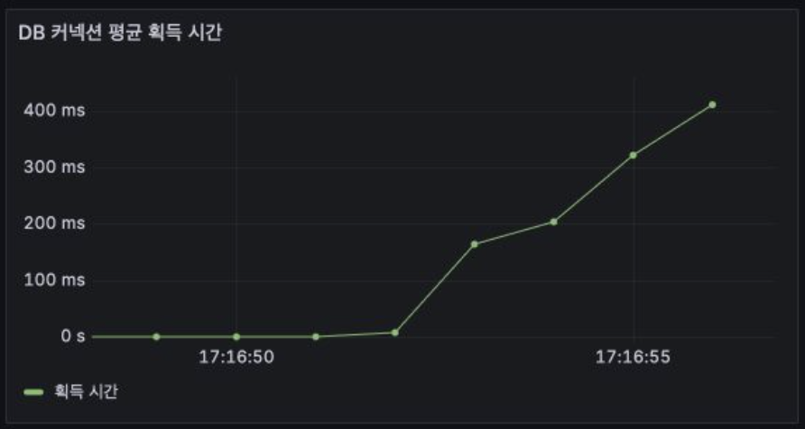</a>
  <a href="images/image-2.png">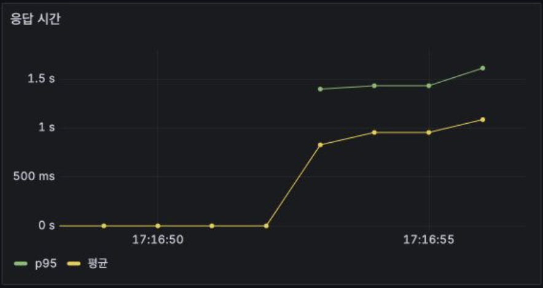</a>

항목 | 목표 | 현재 관측 | 판단 |
|---|---:|---:|---|
| 수정 요청 p95 | ≤ 1.000초 | 1.135초 | 미달 |
| 40건 전체 HTTP 완료 | ≤ 1.000초 | 약 2.190초 | 미달 |
| 사용자별 두 수정 완료 p95 | 참고 지표 | 약 2.194초 | 사용자 흐름도 1초 초과 |
| 기능 오류 | 0건 | 0 / 40건 | 이번 부하에서는 성공 |
| 서비스 중단 | 없어야 함 | 이번 정상 목 테스트에서는 미발생 | 장애 상황 가용성까지 증명한 것은 아님 |
| 커넥션 대기 | 원인 진단 지표 | 최대 관측 10개 | 외부 대기와 자원 경합 확인 |

## 변경 후 측정 환경

**환경**

Spring, PostgreSQL: 각각 CPU 2개, 메모리 1GiB

Redis: CPU 0.5개·메모리 256MiB

현재 로컬 테스트 컨테이너는 256MiB로 제한되어 있으며, Redis 내부 `maxmemory`는 설정되지 않았다. 이 짧은 시험에서 메모리 부족은 관측되지 않았지만, 장기간 대기 작업이 쌓일 때의 메모리 상한과 정리 정책은 별도로 관리해야 한다.

API: 실제 GitHub 대신 호출당 500ms 대기하는 목 클라이언트를 사용

2분 분산 부하와 장애 검증

Docker 환경에서 2분에 걸쳐 실행했다. 20 VU 시험은 사용자당 글 1건씩 총 20건을, 100 VU 시험은 사용자당 글 2건씩 총 200건을 수정했다. 100 VU 시험의 첫 수정은 앞 1분, 두 번째 수정은 다음 1분에 사용자별로 분산했다. 설계서의 20 VU·40건 목표와 이 문서의 20 VU·20건 측정은 요청 수가 달라 직접 비교하지 않는다.

표의 저장 API p95는 k6가 해당 실행의 전체 HTTP 요청으로 계산한 값이다. Grafana 그래프는 시간 구간별 값이라 그래프의 최고점과 표의 p95가 같을 필요는 없다.

## 변경 후 측정 및 장애 검증

### 20 VU

| 지표 | 결과 |
| --- | ---: |
| HTTP 성공 | **20/20건** |
| 저장 API p95 | **163.45ms** |
| 동기화 완료 | **20/20건** |
| 건별 동기화 중앙값 / p95 / 최장 | **2.08초 / 2.50초 / 2.50초** |

  <a href="images/20vu-1644-response.png">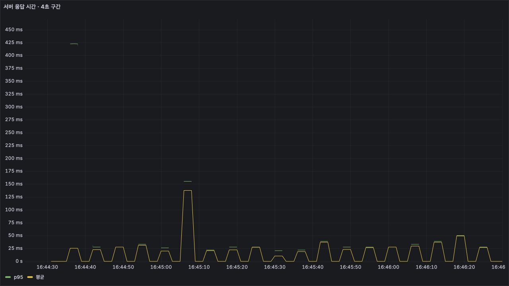</a>
  <a href="images/20vu-1644-p95.png">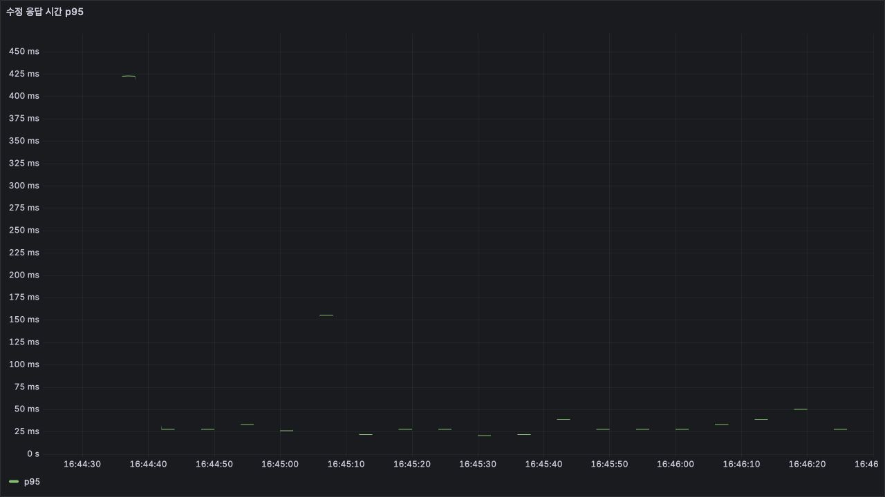</a>

  <a href="images/20vu-1644-db-pending.png">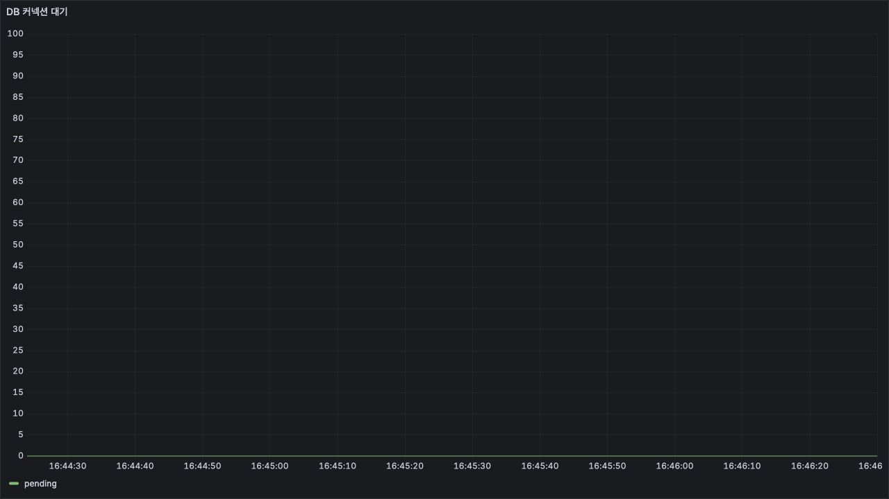</a>
  <a href="images/20vu-1644-stream-lag.png">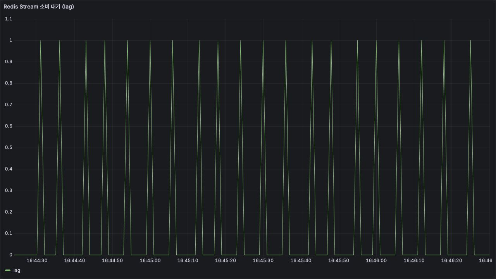</a>

  <a href="images/20vu-1644-stream-pending.png">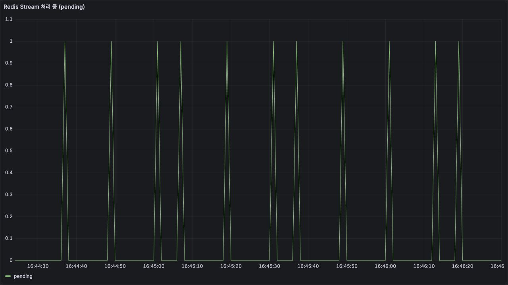</a>
  <a href="images/20vu-1644-redis-memory.png">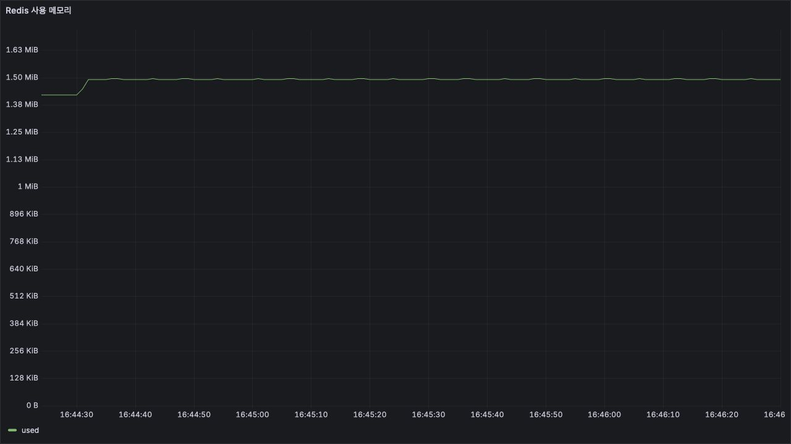</a>

### 100 VU

| 지표 | 결과 |
| --- | ---: |
| HTTP 성공 | **200/200건** |
| 저장 API p95 | **64.95ms** |
| 동기화 완료 | **200/200건** |
| 건별 동기화 중앙값 / p95 / 최장 | **7.53초 / 11.04초 / 13.51초** |

  <a href="images/100vu-1621-response.png">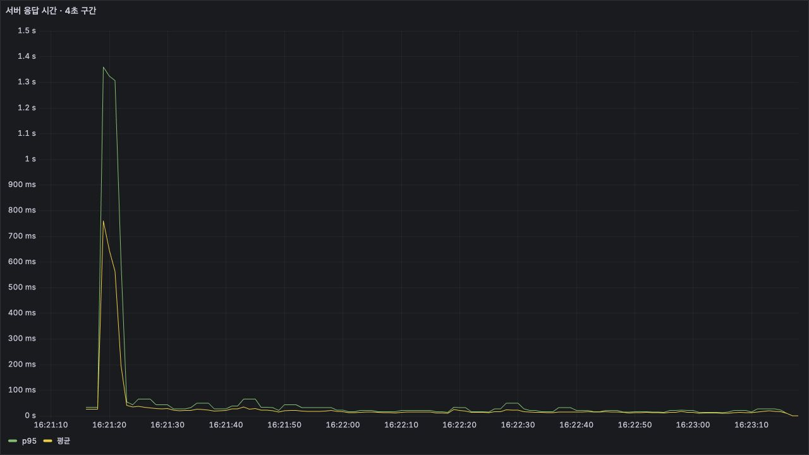</a>
  <a href="images/100vu-1621-p95.png">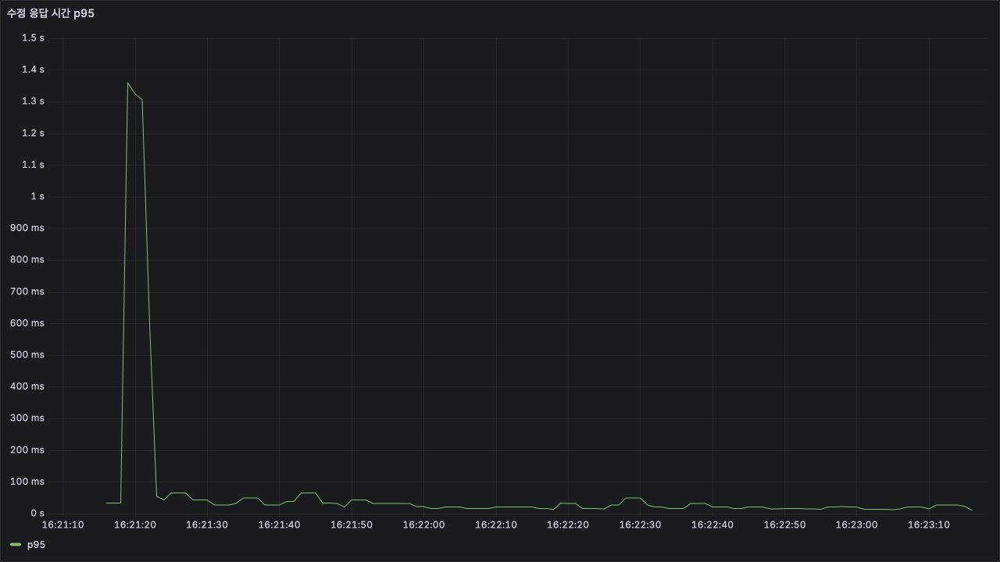</a>

  <a href="images/100vu-1621-db-pending.png">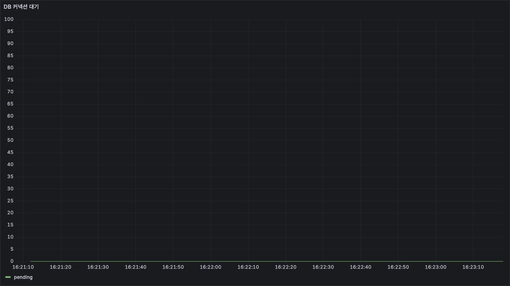</a>
  <a href="images/100vu-1621-stream-lag.png">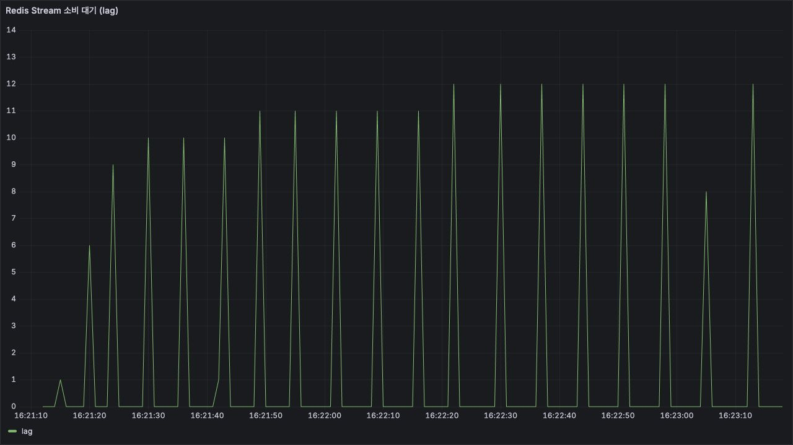</a>

  <a href="images/100vu-1621-stream-pending.png">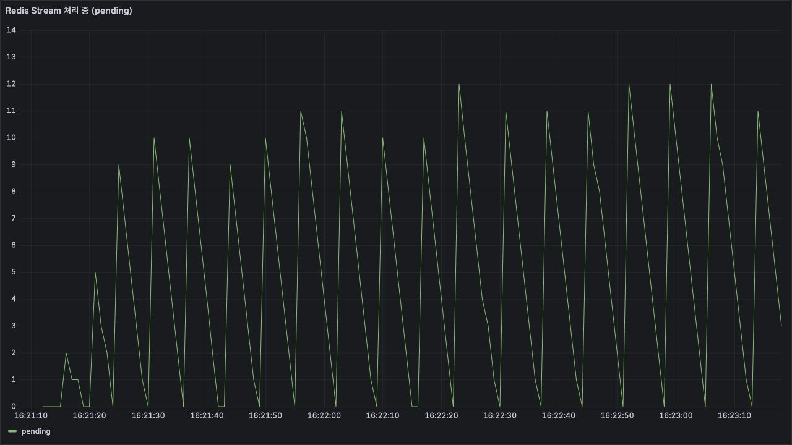</a>
  <a href="images/100vu-1621-redis-memory.png">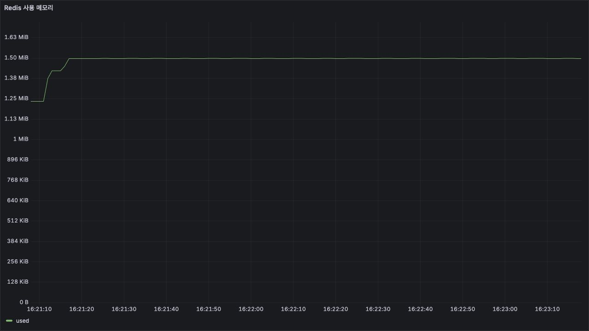</a>

### 장애 상황

GitHub 일시 실패, Redis 중단, PostgreSQL 중단, 백엔드 재시작은 **100명 200건을 2분에 분산**한 채 각각 새 환경에서 실행했다. GitHub 지속 실패는 20명 40건으로 실행했다. 1,000명 장애 시험은 실행하지 않았다.

| 상황 | 저장 API | 최종 아웃박스 | 동기화 p95 | 해석 |
| --- | ---: | ---: | ---: | --- |
| GitHub 목 호출 처음 10회 실패 | 200/200 성공 | 200 `COMPLETED` | 13.03초 | 재시도 후 모두 완료 |
| Redis 15초 중단 후 복구 | 200/200 성공 | 200 `COMPLETED` | 23.43초 | DB에 남은 작업을 복구 후 처리 |
| PostgreSQL 15초 중단 후 복구 | 199/200 성공, HTTP 500 1건 | 저장된 199건 `COMPLETED` | 27.78초 | DB 중단 중 저장 보장 불가 |
| 백엔드 재시작 | 175/200 성공, 연결 실패 25건 | 저장된 175건 `COMPLETED` | 11.97초 | 단일 인스턴스 재시작 중 무중단 아님 |
| GitHub 목 호출 지속 실패 | 40/40 저장 성공 | **40 `FAILED`** | 해당 없음 | 재시도 상한 뒤 운영자 처리 필요 |

GitHub 일시 실패 시험에서는 최장 동기화가 16.36초였다. 목 클라이언트 실패 로그 10건을 확인했고, 모든 작업이 최종 완료됐다.

<a href="images/image-5.png">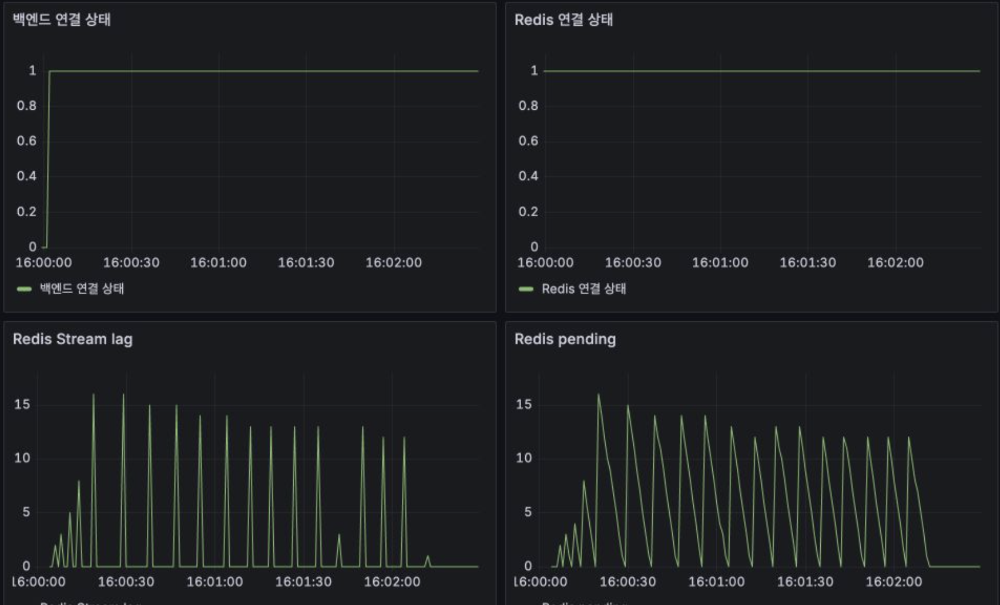</a>

Redis 중단 시험에서는 연결 상태가 0으로 떨어지는 구간과 복구 후 Stream 대기량이 줄어드는 모습이 보인다. 건별 동기화 중앙값은 19.44초, 최장은 28.13초였다.

<a href="images/image-6.png">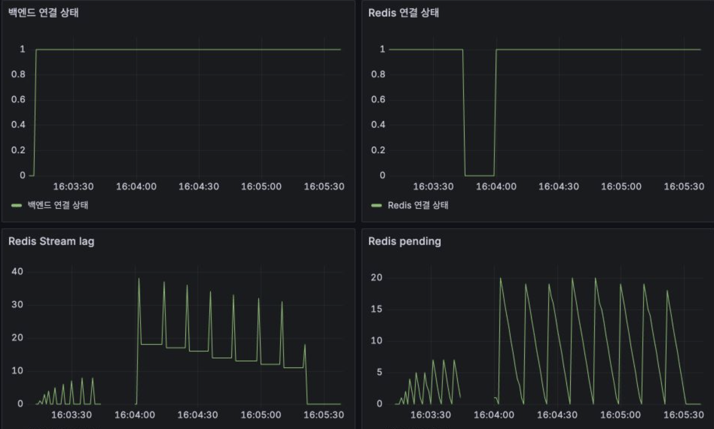</a>

PostgreSQL 중단 시험은 요청 중 하나가 HTTP 500을 반환했다. 다른 요청도 DB 복구를 기다려 저장 API p95가 **11.98초**로 늘었다. 복구 뒤 DB에 기록된 199건은 모두 완료됐지만, 실패한 1건에는 아웃박스 작업이 없다.

<a href="images/image-7.png">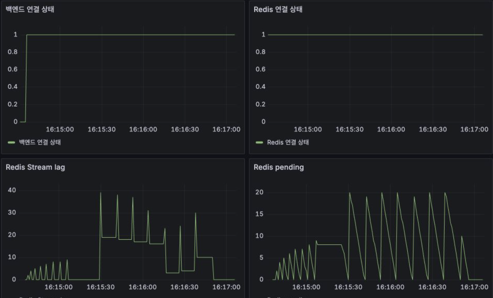</a>

백엔드 재시작 중에는 `EOF` 24건과 연결 거부 1건이 발생했다. 재시작 후에는 접수된 175건의 작업이 모두 완료됐다. 이 시험은 **작업 복구**를 확인한 것이며 **요청 무중단**을 확인한 것이 아니다.

<a href="images/image-8.png">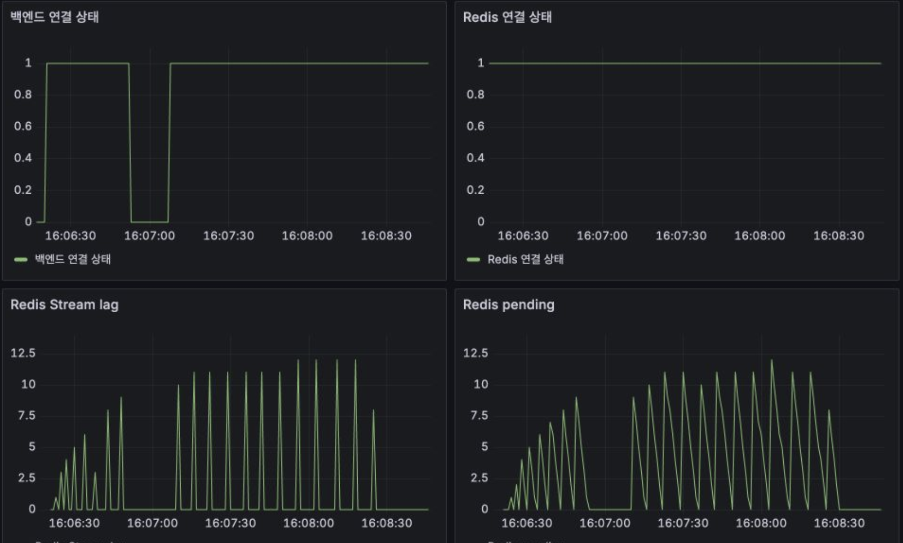</a>

GitHub가 계속 실패한 시험은 저장 요청 자체에는 영향을 주지 않았다. 하지만 동기화는 성공하지 못했고, 40건 모두 `FAILED`에 도달하는 데 첫 저장부터 **261.21초**가 걸렸다. 이 값은 동기화 완료 시간이 아니라 **실패 상태 확정 시간**이다.

<a href="images/image-9.png">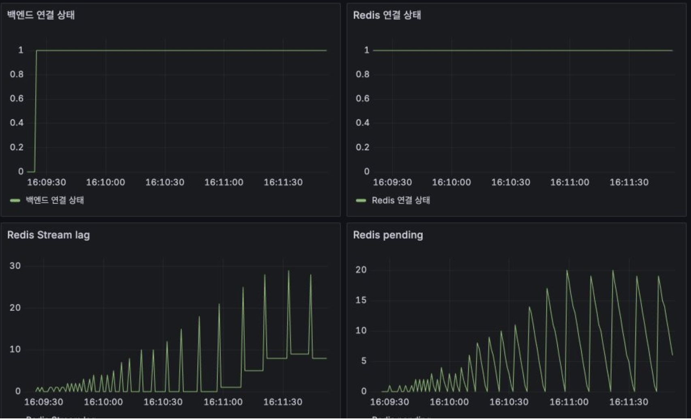</a>

### 평가

현재 구조는 저장 트랜잭션에서 외부 호출을 분리해, GitHub나 Redis가 느리거나 멈춰도 **접수된 글 변경과 아웃박스 기록을 보존**한다. 반면 소비자가 목 GitHub 호출을 순차 처리하므로 작업이 들어오는 속도에 따라 반영 지연이 커진다. 100명·200건 시험에서 저장 API p95는 64.95ms였지만 동기화 p95는 11.04초였다. 두 지표를 별도로 운영해야 한다.

또한 DB 중단 중의 저장 요청과 단일 백엔드 재시작 중의 요청은 실패할 수 있다. 아웃박스는 이미 접수된 작업을 복구하는 방식이지, 단일 인스턴스나 DB의 무중단을 보장하지 않는다. `FAILED` 작업은 자동 성공으로 처리하지 않고 재처리, 알림 절차가 필요하다.
